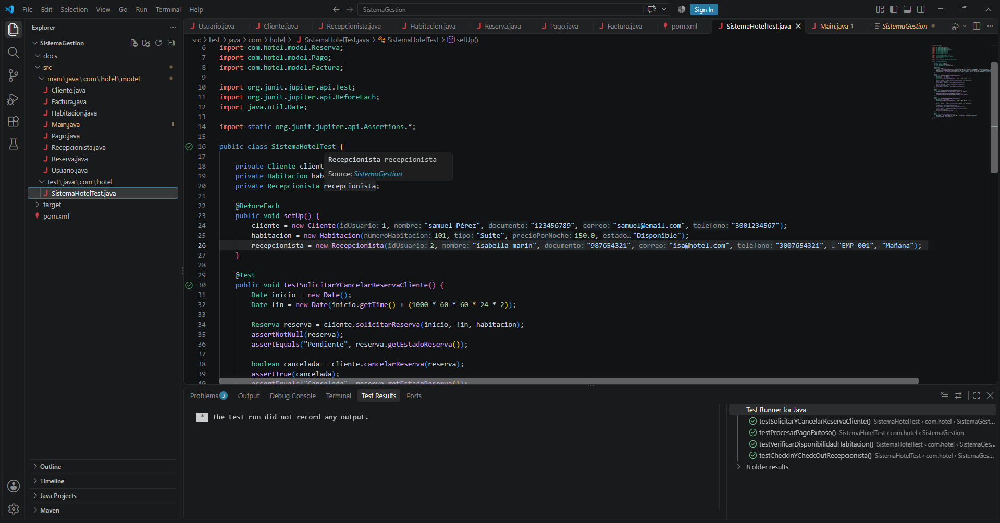
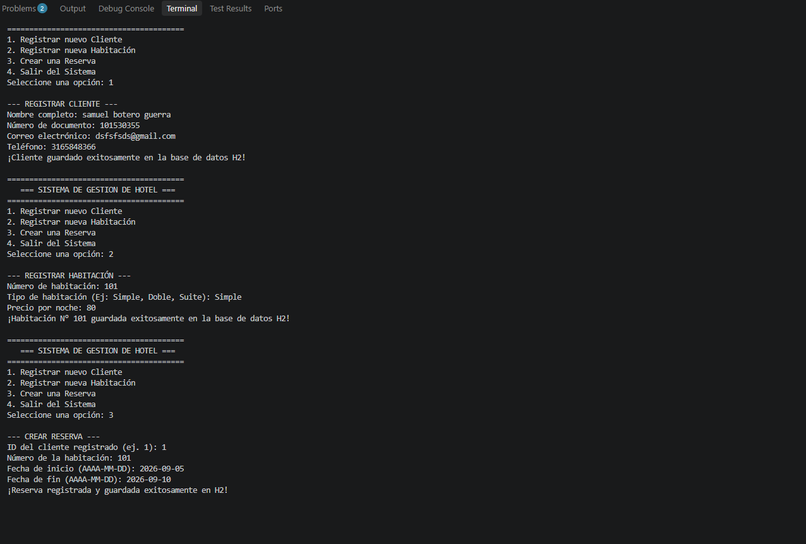
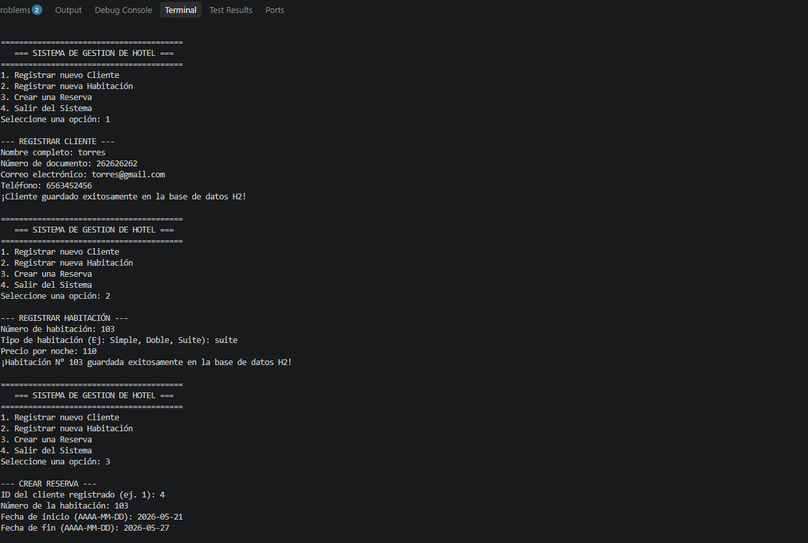
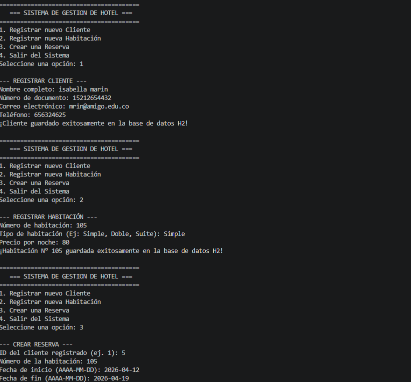
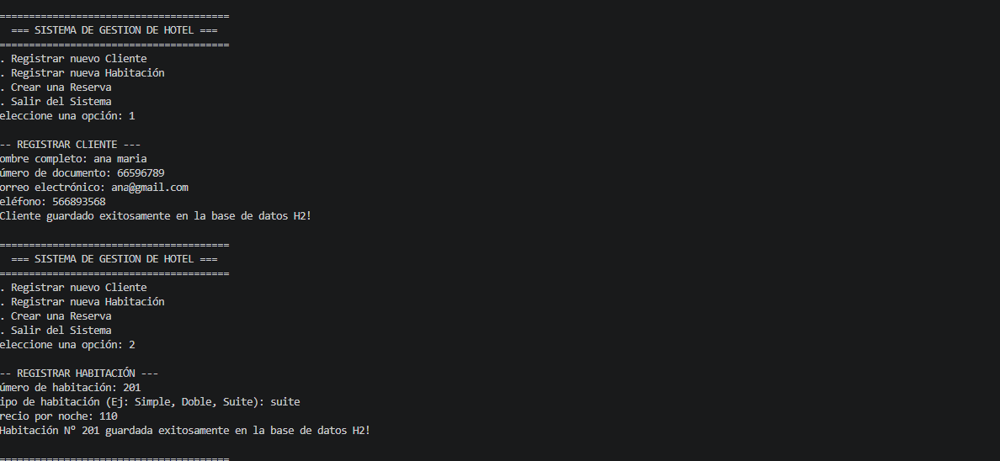

# Sistema de Gestión de Hotel - Solución en Java

## Descripción
Proyecto de software desarrollado en Java para la gestión automatizada de un hotel pequeño/mediano, abarcando el registro de clientes, catálogo de habitaciones, solicitudes de reservas, control de accesos y persistencia de datos relacional.

## Tecnologías Utilizadas
- **Lenguaje:** Java 17+
- **Gestor de dependencias / Compilación:** Maven (`pom.xml`)
- **Base de Datos:** H2 Database (Modo archivo local: `./data/hoteldb`)
- **Pruebas Unitarias:** JUnit 5
- **Documentación:** JavaDoc y manuales integrados

## Estructura del Proyecto
- `src/main/java/com/hotel/`: Paquete principal de la aplicación.
  - `config/`: Clases de conexión y creación automática de tablas (`ConexionDB.java`, `InicializadorBD.java`).
  - `dao/`: Objetos de Acceso a Datos para la persistencia SQL (`ClienteDAO.java`, `HabitacionDAO.java`, `ReservaDAO.java`).
  - `model/`: Clases principales del modelo (`Usuario`, `Cliente`, `Recepcionista`, `Habitacion`, `Reserva`, `Pago`, `Factura`).
- `src/main/java/com/hotel/Main.java`: Controlador principal con menú interactivo por consola (`Scanner`).
- `src/test/java/com/hotel/`: Contiene las pruebas unitarias (`SistemaHotelTest.java`).
- `docs/capturas/`: Evidencias gráficas del funcionamiento del sistema y pruebas.

---

## Manual de Usuario
1. **Inicio del Sistema:** Al ejecutar la clase `Main.java`, la aplicación inicializa automáticamente la base de datos local y despliega el menú interactivo en la terminal.
2. **Opciones del Menú:**
   - **Registrar Cliente:** Solicita nombre, documento, correo y teléfono, almacenándolos con un ID autoincremental en la base de datos.
   - **Registrar Habitación:** Permite dar de alta una habitación indicando su número, tipo, precio por noche y disponibilidad.
   - **Crear Reserva:** Vincula un cliente existente (por su ID) y una habitación registrada con las fechas de inicio y fin (`AAAA-MM-DD`).
   - **Salir:** Cierra la ejecución del programa de forma segura.

---

## Manual Técnico
- **Persistencia de Datos:** Se implementó **H2 Database** configurada en modo archivo (`./data/hoteldb`), asegurando que la información persista en el disco duro al cerrar la aplicación.
- **Arquitectura:** Se utilizó el patrón **DAO (Data Access Object)** para separar la lógica de negocio de las operaciones SQL utilizando consultas preparadas (`PreparedStatement`).
- **Integridad Referencial:** Las tablas (`cliente`, `habitacion`, `reserva`) están conectadas mediante llaves foráneas (`FOREIGN KEY`), garantizando que no se puedan realizar reservas sin un cliente o habitación válidos previamente registrados.

---

## Pruebas y Funcionamiento

### 1. Pruebas Unitarias Exitosas (JUnit 5)

### 2. Ejecución del Sistema en Consola (Main)

